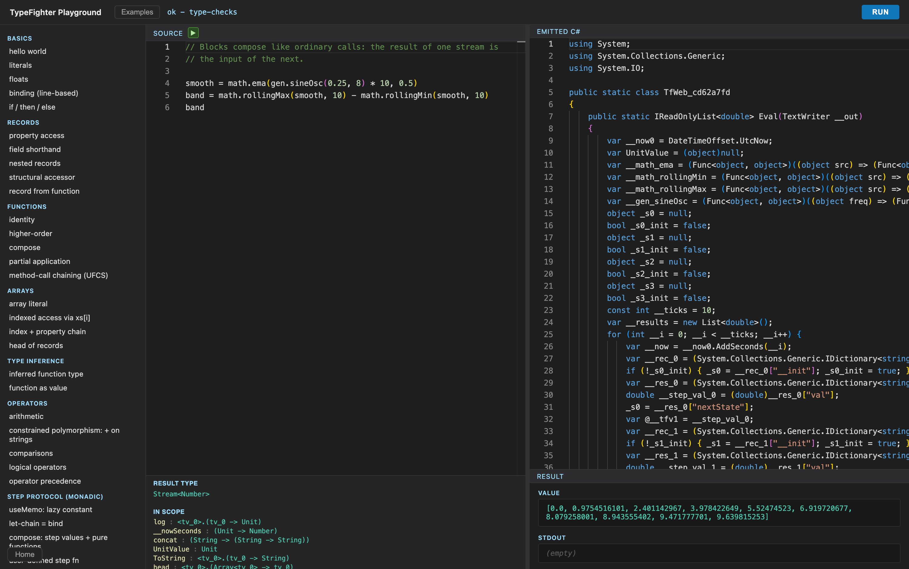
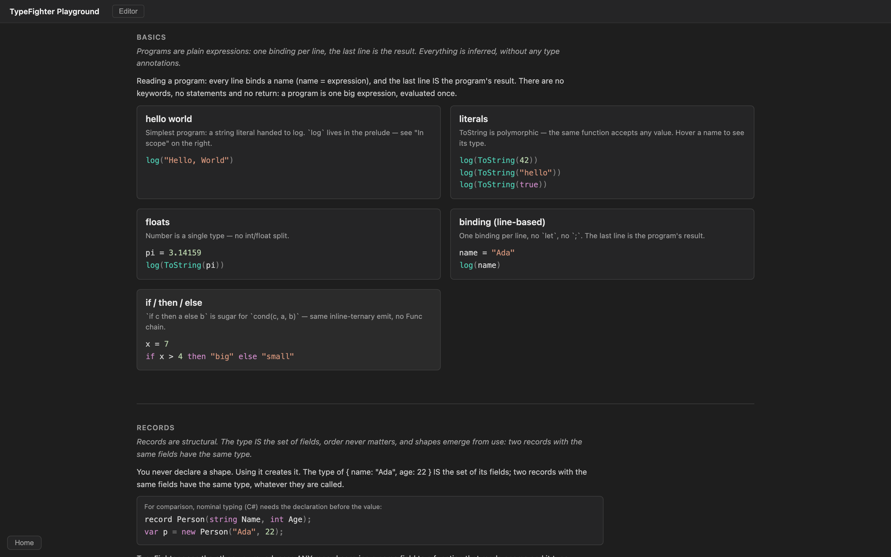

<p align="center">
  
</p>

<h1 align="center">TypeFighter</h1>

<p align="center">
  An embeddable, inference-first expression language for .NET:<br/>
  scripts feel dynamic, but every program is fully type-checked before it runs.
</p>

<p align="center">
  <b><a href="https://schlenkr.github.io/TypeFighter/">Open the playground</a></b> - the complete compiler (including Roslyn) runs in your browser, no backend.
</p>

## The idea

You want users to script your application: formulas, rules, stream processing. A dynamic language is easy to embed but fails at runtime, in production. A static language pushes declarations and annotations onto people who just want to write a formula. TypeFighter takes a third path:

- programs look like a scripting language: no type annotations, no declarations, no keywords
- a Hindley-Milner-style checker with constraints infers everything and rejects wrong programs before they run
- programs compile to plain C# and run wherever .NET runs - including the browser
- the language is total: no loops, no recursion - embedded user code always terminates

## The language in five snippets

### Everything is inferred

<table>
<tr>
<td width="50%">

```
greet = s => concat("Hello, ", s)
log(greet("Ada"))
```

</td>
<td width="50%">

```
greet : String -> String
```

</td>
</tr>
</table>

Programs carry no type annotations. The checker works out every type from how names are used - hover any name in the playground to see the result.

### Records are structural

<table>
<tr>
<td width="50%">

```
getName = r => r.name
log(getName(name: "Ada", age: 42))
```

</td>
<td width="50%">

```csharp
// nominal typing (C#): declare first
record Person(string Name, int Age);
var p = new Person("Ada", 42);
p.Name
```

</td>
</tr>
</table>

The type of a record IS the set of its fields. Using a shape creates it; nothing is declared up front, and two records with the same fields have the same type. Wrong shapes are caught precisely:

```
p = { x: 1, y: 2 }
p.z    // Type error: Member 'z' is missing in record type { x: Number & y: Number }
```

### Types are sets

<table>
<tr>
<td width="50%">

```
s = "Hello, " + "World"
n = 1 + 2
```

</td>
<td width="50%">

```
+ : <tv_0> where tv_0 in (Number | String)
```

</td>
</tr>
</table>

Literal types and unions are ordinary sets - Boolean is just the union `true | false`, and `+` is constrained-polymorphic over `Number | String`. A constraint stays a set until a use site pins it down.

### Fields are functions

<table>
<tr>
<td width="50%">

```
shout = s => concat(s, "!!!")
greet = s => concat("Hello, ", s)
"Ada".greet().shout()
```

</td>
<td width="50%">

```
// the same program, written as calls
shout(greet("Ada"))

// result
"Hello, Ada!!!"
```

</td>
</tr>
</table>

`x.f(args)` is a scope rule, not a method system: if `f` is a visible function it is applied to `x`, otherwise it is field access. Record fields are themselves functions, so both readings of the dot follow one rule - and chains read left to right like a pipeline.

### Streams are compiled state machines

<table>
<tr>
<td width="50%">

```
i = count
doubled = i * 2
doubled + 1
```

</td>
<td width="50%">

```
// 10 ticks
[1, 3, 5, 7, 9, 11, 13, 15, 17, 19]
```

</td>
</tr>
</table>

A binding whose right side is a stream becomes one step of a compiled C# state machine - `=` is monadic bind. Streams are not a language feature but one interpretation of a structural step protocol, and a small block library (`math`, `gen`, `logic`, `dsp`) builds on it:

```
smooth = math.ema(gen.sineOsc(0.25, 8) * 10, 0.5)
band = math.rollingMax(smooth, 10) - math.rollingMin(smooth, 10)
band
```

## The playground

The playground shows the whole pipeline live: source, inferred types, the emitted C#, and the result. The docs page walks through the language top to bottom - every concept explained, every example one click away from running. And because the compiler itself runs in the browser (WebAssembly), the site is fully static.

[](https://schlenkr.github.io/TypeFighter/)

[](https://schlenkr.github.io/TypeFighter/)

## Running it locally

```bash
./build-wasm.sh          # publish the WASM compiler into site/public/wasm
pnpm install
cd site && pnpm dev      # http://localhost:3100

dotnet test              # language test suite
```

> Companion repository for the YouTube video: [Type Inference Explained](https://www.youtube.com/watch?v=fSRTVrjvo70)

## License

This project is **not available for use** in any projects, whether commercial or non-commercial. If you are interested in using it, please [contact me](https://github.com/SchlenkR) directly.
